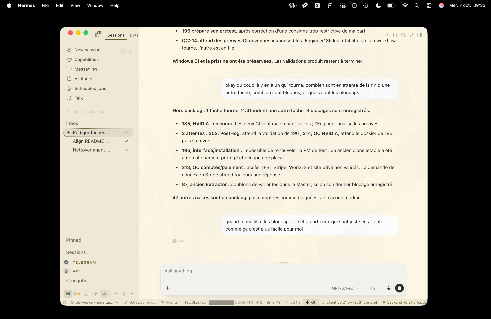
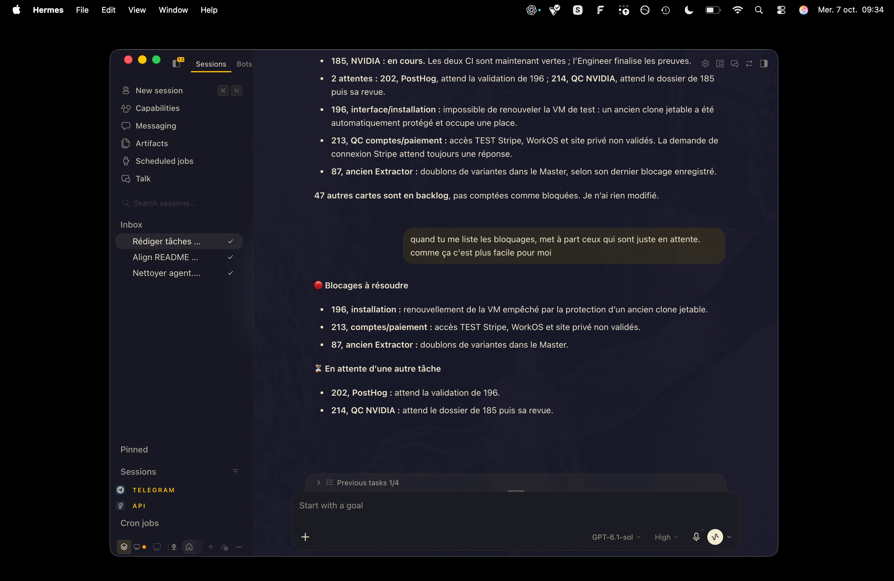
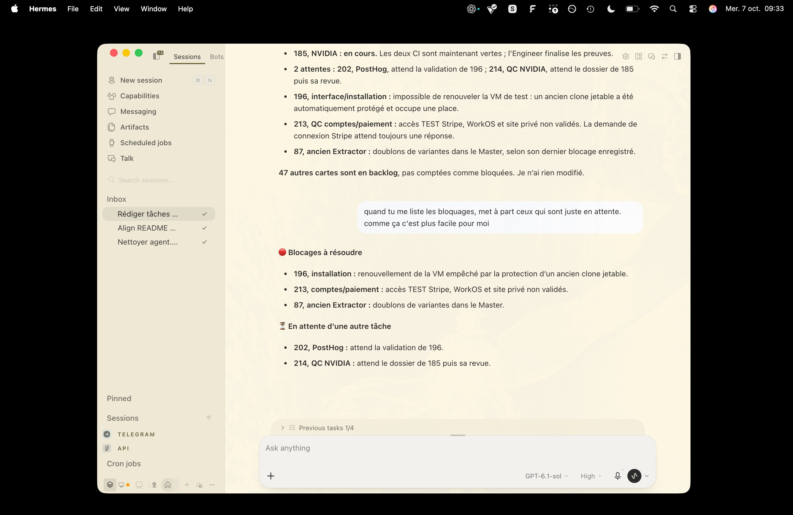
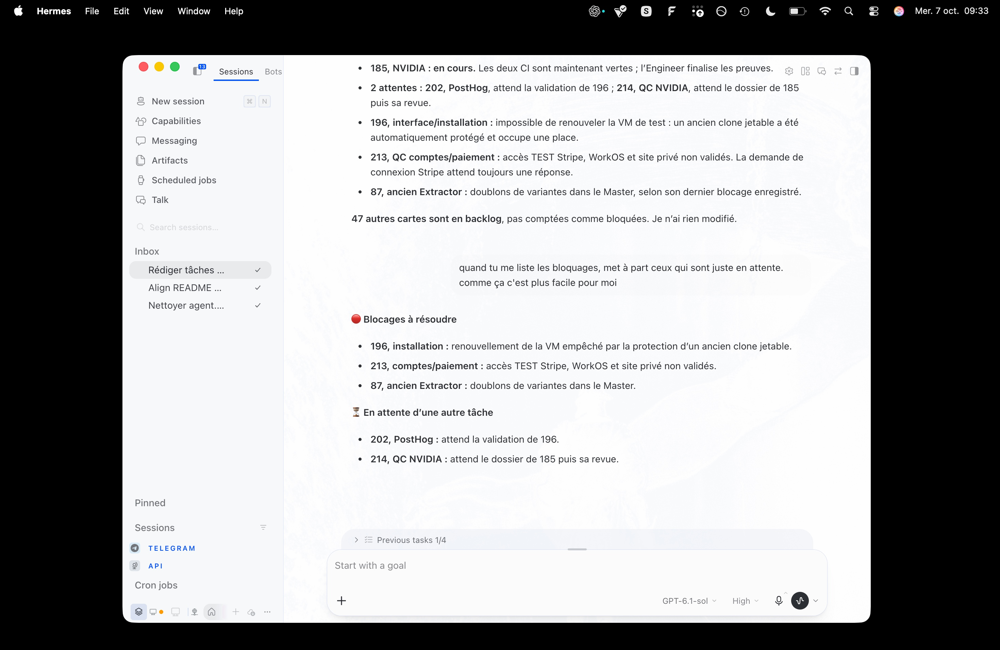
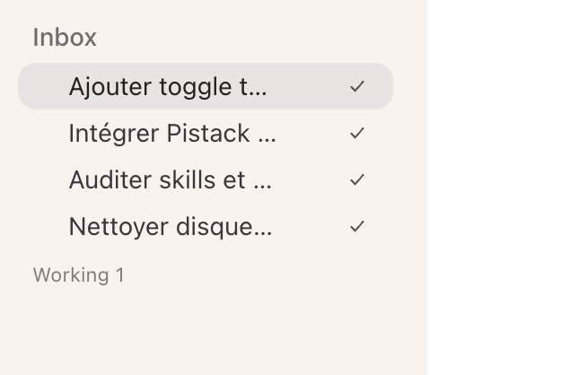

# Codex Skin for Hermes Desktop

**Have an idea, a bug report or an improvement? Please open an [issue](https://github.com/FPSUnleashed/hermes-codex-skin/issues) or a [pull request](https://github.com/FPSUnleashed/hermes-codex-skin/pulls).** If you've improved your own fork, I'd love for you to share it here so everyone can benefit. I'm happy to review contributions and include those that fit the project, with credit to you.

<p>
  <a href="docs/images/skin-cream.jpg"></a>
  <a href="docs/images/skin-dark.jpg"></a>
  <a href="docs/images/skin-light.jpg"></a>
  <a href="docs/images/skin-white.jpg"></a>
</p>

These are historical screenshots from earlier releases; they do not show every control or behavior described below.

Codex-inspired chat layout for Hermes Desktop, with native theme colors, six optional T3 themes, Glass/Clear backgrounds, expandable work summaries, history previews and a task Inbox. Native model menus, voice controls and Queue behavior remain Hermes-owned.

> [!IMPORTANT]
> This project is an independent community plugin. It is not affiliated with or endorsed by Nous Research or OpenAI.

## Current release

**[v1.13.0](https://github.com/FPSUnleashed/hermes-codex-skin/releases/tag/v1.13.0)** redesigns the chat's layout, message display, tool activity and navigation, with six new themes and expanded Inbox controls. See the [changelog](CHANGELOG.md) for the full history.

`main` can receive tested improvements before a tagged release; merging does not replace existing release assets. The manual commands below install the exact v1.13.0 release.

**Older Desktop layout?** Use [v1.6.0](https://github.com/FPSUnleashed/hermes-codex-skin/releases/tag/v1.6.0), not v1.13.0 or `main`. See [Compatibility](#compatibility).

## Install

Requires Hermes Desktop with the [Desktop Plugin SDK](https://hermes-agent.nousresearch.com/docs/developer-guide/desktop-plugin-sdk) and a writable local plugin folder. Install on the computer running **Desktop**, not only on a remote Agent.

### Current Hermes Desktop

Open **Capabilities → Plugins → Install plugin** and paste this exact repository subdirectory:

```text
FPSUnleashed/hermes-codex-skin/codex-chat-look
```

This repository path is not pinned to v1.13.0; `main` may include newer improvements. For an exact stable version, use the pinned manual download below. Keep the `/codex-chat-look` suffix; do not use a GitHub `/blob/.../plugin.js` HTML page as the plugin file.

### Manual install on macOS / Linux

```sh
PLUGIN_DIR="${HERMES_HOME:-$HOME/.hermes}/desktop-plugins/codex-chat-look"
mkdir -p "$PLUGIN_DIR"
curl -fsSL \
  https://raw.githubusercontent.com/FPSUnleashed/hermes-codex-skin/v1.13.0/codex-chat-look/plugin.js \
  -o "$PLUGIN_DIR/plugin.js"
```

### Manual install on Windows PowerShell

```powershell
$pluginDir = Join-Path $HOME ".hermes\desktop-plugins\codex-chat-look"
New-Item -ItemType Directory -Force -Path $pluginDir | Out-Null
Invoke-WebRequest `
  -Uri "https://raw.githubusercontent.com/FPSUnleashed/hermes-codex-skin/v1.13.0/codex-chat-look/plugin.js" `
  -OutFile (Join-Path $pluginDir "plugin.js")
```

Hermes watches the plugin folder. Enable the skin under **Capabilities → Plugins**. If the old appearance remains, use **Reload desktop plugins** where supported; older builds may need an app restart to reevaluate an already-loaded file.

To verify a manual download, use the [checksums from the same tag](https://github.com/FPSUnleashed/hermes-codex-skin/blob/v1.13.0/CHECKSUMS.sha256), not a moving `main` checksum.

## Adjustable settings

Open the command palette and search for **Codex Skin:**. Choices persist locally.

| Setting | Values | Default |
| --- | --- | --- |
| Composer width | Codex / Codex +20 % / Codex +40 % / Hermes | Codex |
| Pinned user messages | Hermes / Off | Hermes |
| Show complete messages | On / Off | On |
| Inbox | On / Off | On |
| Floating sidebar | On / Off | On |
| Inbox only (Beta) | On / Off | Off |
| Universal Inbox (Beta) | On / Off | Off |
| Share usage statistics | On / Off; confirmation required to enable | Off |


Enable or disable the skin under **Capabilities → Plugins**. Under **Settings → Appearance**, choose **Codex Skin**, **T3 Chat**, **T3 Code**, **T3 Ocean**, **T3 Iris**, **T3 Grove** or **T3 Ember**, or keep your native Hermes theme. Each bundled theme has light and dark appearances. Installing the plugin does not select a theme. The skin follows Hermes' selected UI font family.

For the recommended Codex-style setup, use **Composer width: Codex** and **Pinned user messages: Off**. These recommendations do not change the defaults. The default Codex width uses T3-style conversation/composer alignment; the wider and native Hermes choices remain available.

**Expandable activity replaces Clean transcript.** Each turn shows its latest assistant reply by default, including during work. Earlier replies, even different answers, remain accessible by expanding **Working** or **Worked**; they are not deleted. Consecutive tools and reasoning share expandable activity rows. The latest chronological tool stays visible and clickable until prose follows, then becomes a factual summary. Completed activity folds under **Worked for …**, or **Worked** when duration is unknown. User messages, media, artifacts, alerts and interactive content stay accessible. Uncertain historical content stays visible when it cannot be folded safely, and failed or interrupted turns keep their activity open. The old Clean transcript setting and its saved On/Off choices no longer control this presentation. This is a reversible display policy, not a fix for native message duplication.

**Show complete messages** is On by default. Each assistant text part appears when that part finishes, while work indicators, tools and Stop remain available. Turn it Off to watch text stream incrementally. This setting is separate from activity expansion.

See [detailed settings and history navigation](docs/usage.md) for widths and behavior.

## Inbox

Think of each thread as an independent task. Inbox appears above Pinned and Sessions and is **On by default**. Verified new work adds a chat. See the known issues below for false activity when opening older conversations.

- **Settle:** hover or keyboard-focus the row and click the right-hand checkmark when a task is finished. It hides the thread from Inbox without stopping, archiving, deleting or unpinning it. The latest settlement offers Undo for three seconds. New work can bring the thread back. Actions that require fresh owner or activity verification remain unavailable until that verification succeeds.
- **Snooze:** use the left clock and choose **In 1 hour**, **In 3 hours**, **Tomorrow** or **Next week**. The menu shows local wake times. Tomorrow means 09:00 the next calendar day; Next week means 09:00 next Monday. Work continues while snoozed.
- **Snoozed:** expand **Snoozed N**, below Working, to find snoozed threads. Opening one does not wake it. Use its upward-arrow **Cancel snooze** action to return it early; active work returns to Working. Expiry restores attention without navigating.
- Settling or snoozing the current thread opens the next Inbox thread, or a new chat when none remains in the loaded list.

### Working group



Historical capture. Inbox action visibility has since changed to hover or keyboard focus.

Working is part of Inbox, not a separate setting. Inbox is **On by default**. Open the command palette (**⌘K** on macOS, **Ctrl+K** on Windows/Linux) and run **Codex Skin: Inbox** to turn the whole Inbox, including Working, **On** or **Off**. Your choice persists locally.

While Inbox is On, running threads leave the main Inbox list. A discreet **Working 3** label at the bottom of Inbox shows how many threads are grouped there. Click it to reveal those threads directly underneath; click again to collapse them. The group starts collapsed and disappears when empty. Active subagents keep their parent thread in Working, but each thread counts only once.

A thread returns to the main list when its work ends. Questions and approval requests bring it back immediately with an amber Needs input dot, even while subagents are running. Unverified activity stays in the main list rather than being hidden. Settled and snoozed threads remain excluded. Turning Inbox Off removes the Inbox groups without stopping work, archiving a chat or changing Settle/Snooze state. The independent Inbox only setting can still hide Pinned and Sessions; turn it Off to show those native lists.

The goal is to have **an empty Inbox at the end of the day**.

I recommend keeping Pinned and Sessions collapsed to focus on Inbox. Expand Sessions for older chats and Hermes' full native context menu. Turn Inbox off through **Codex Skin: Inbox** without erasing saved Settle/Snooze state.

**Inbox only (Beta)** optionally hides Pinned and Sessions without deleting threads. It is Off by default and independent of the Inbox switch; turn it Off to show those lists again.

**Universal Inbox (Beta)** optionally combines verified threads from available connections and profiles. It is Off by default. Profile badges identify threads from another owner; opening and acting on a thread uses its own connection and profile. Unavailable or unverified owners do not gain live-action authority.

**Known limitation:** cron sessions are excluded, but cron-triggered work delivered into a regular chat may still appear as that chat's activity when Hermes does not expose its origin.

Restore badges are hidden when a row's connection/profile cannot be verified. See the [Inbox design note](docs/inbox.md) for ownership checks, activity indicators and persistence.

## Known issues

Opening an older conversation can still briefly show it as Working or add it to Inbox without new work. Chat flicker on opening older conversations has also been reported and is not yet resolved.

## Update

On supported Desktop builds, the plugin checks GitHub for stable releases on launch, hourly, and when stale information needs refreshing on app activation or reconnection. **Downloading and installing requires your click.**

A small blue button appears beside the composer's `+` when an update is available. Hover to read release notes; click to update. The updater verifies the download, saves a rollback copy and confirms hot reload before showing success. Your settings stay unchanged.

In-app updates require Desktop's local plugin-folder, file-read/write and hot-reload capabilities. Updating only a remote Agent does not upgrade the Desktop shell. Versions before v1.8.0 need one manual update to receive the updater.

Verification and trust limits are documented in [SECURITY.md](SECURITY.md).

## Uninstall

Disable **Codex Skin** under **Capabilities → Plugins** to restore Hermes' normal appearance. To remove it from disk, follow the [uninstall commands](docs/usage.md#uninstall).

## Privacy and authority

The plugin has renderer-level app authority, not a sandbox. It has no separate backend and does not modify Hermes source files or take ownership of Queue data.

GitHub receives requests for release metadata, permitted images when you open the update menu and the plugin asset when you click to update. No chat content is sent to GitHub. History previews and Inbox use Hermes' own session APIs.

**Usage statistics are Off by default.** You can enable **Codex Skin: Share usage statistics** after an explicit confirmation. It sends limited usage events to PostHog's EU ingestion service: a random persistent installation ID, plugin version, OS family and fixed activity/feature/failure categories. It does not send conversations, prompts, thread titles, files or raw errors. The ID is pseudonymous, not fully anonymous, and PostHog receives network metadata including your IP address. Do Not Track and Global Privacy Control block collection. Turning the setting Off stops collection and removes the local ID; it does not delete events already received by PostHog.

Settings, thread identifiers, attention state, optional statistics consent/ID and update receipts/files are stored locally, not message text or content fingerprints. See [SECURITY.md](SECURITY.md) for the full trust and storage model.

## Compatibility

v1.13.0 targets the updated Desktop layout introduced by the September 16, 2026 panel-header and virtualized-timeline changes ([Hermes commit 2efbbef](https://github.com/NousResearch/hermes-agent/commit/2efbbef981cc75ed6df6214ee6975a0ae0f418d3)). The skin styles internal Desktop elements, so later UI changes can require a compatibility update. This is not a guarantee for every future Hermes build.

**Hermes Agent and Hermes Desktop can update independently.** A backend version alone does not establish the Desktop layout or updater capabilities.

For the older layout, including Desktop code from Hermes Agent 0.21.3 / v2026.9.14 or earlier, use the [pinned v1.6.0 instructions](docs/usage.md#older-desktop-layout-v160). Keep that version while staying on the older layout.

Titlebar autohide was removed because the updated header keeps tabs and window controls directly accessible. Old saved values are ignored. The internal plugin/folder ID remains `codex-chat-look`, and the theme ID remains `codex-chat`, preserving existing installations.

## More information

- [Detailed settings, older installs and historical screenshots](docs/usage.md). Existing captures show earlier releases, not every current control or behavior.
- [Inbox design and behavior](docs/inbox.md)
- [Security policy](SECURITY.md)
- [Reference provenance and third-party licenses](docs/reference-provenance.md)
- [Contributing](CONTRIBUTING.md). Skin bugs belong here; Hermes-native bugs belong upstream, not in skin workarounds.
- [MIT license](LICENSE)

## Contributors

Thanks to [@subhead](https://github.com/subhead) for the Floating sidebar layout and [@DoGMaTiiC](https://github.com/DoGMaTiiC) for the deleted-session Inbox fix in [#39](https://github.com/FPSUnleashed/hermes-codex-skin/pull/39).
