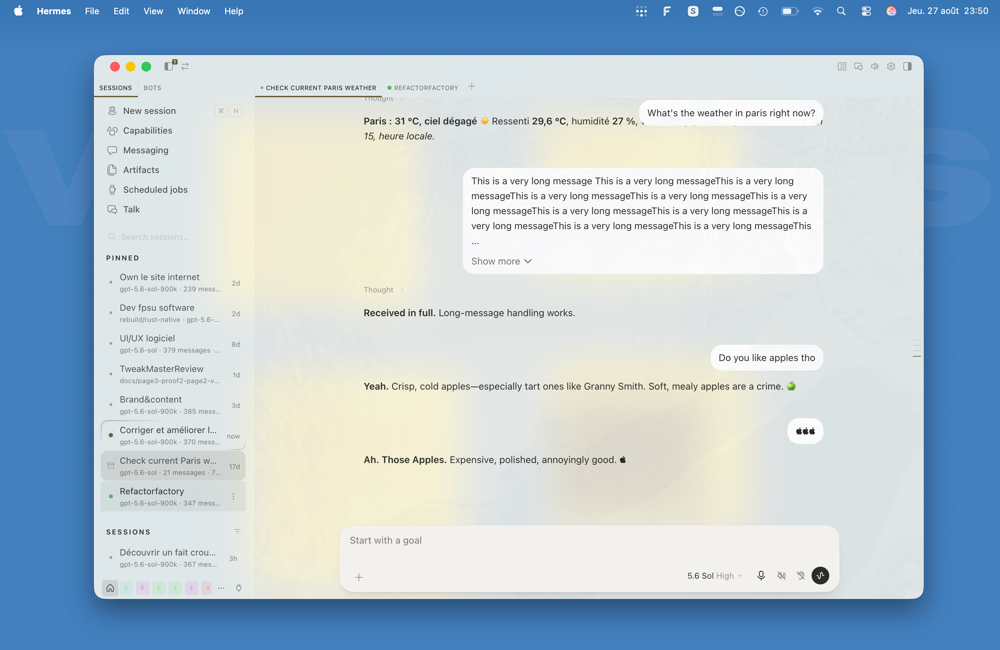

# Settings, older installations and historical screenshots

[Back to the README](../README.md)

## Detailed settings

### Composer width

Open the command palette and run **Codex Skin: Composer width**. Each run cycles **Codex → Codex +20 % → Codex +40 % → Hermes → Codex**. The row shows the active mode and the choice persists locally. Codex remains the default; existing choices are preserved.

- **Codex** uses a **46rem** maximum with T3-style responsive side insets and scrollbar compensation to align the conversation and composer.
- **Codex +20 %** retains its existing **883.2 CSS px** maximum.
- **Codex +40 %** retains its existing **1030.4 CSS px** maximum. These are the existing setting labels; their fixed pixel widths do not promise exact percentage scaling against a rem-based default at every root font size.
- **Hermes** restores Hermes' native full-width composer and conversation column.

Codex modes shrink to fit narrow panes. The default lane uses .75rem side insets on narrow layouts and 3rem on wider layouts. Floating and popped-out composers retain their native Hermes width in every mode. The `+` menu above the composer follows the rendered composer width in all four modes.

### Pinned user messages

Open the command palette and run **Codex Skin: Pinned user messages**. The row shows the active mode and the choice persists locally.

- **Hermes** preserves Hermes' native behavior, where the latest user message stays pinned at the top while scrolling.
- **Off** lets every user message scroll normally with the rest of the conversation.

### Expandable activity

Each turn shows its latest assistant reply by default, including during work. Earlier replies, even different answers, are folded into expandable **Working** or **Worked** activity rather than deleted. Completed activity folds under **Worked for …**, or **Worked** when no duration can be verified. Click the summary to revisit earlier replies, tools, reasoning and progress narration; nested native calls and results remain available. Failed or interrupted turns keep their activity open. User messages, media, artifacts, alerts and interactive content stay accessible.

Consecutive tools and reasoning share expandable rows. The latest chronological tool stays visible and clickable until prose follows, then becomes a factual summary. Reopen it to inspect all grouped commands and results.

This replaces the old Clean transcript setting and its hide-all behavior. Saved Clean transcript On/Off values no longer control presentation. Uncertain historical content stays visible when it cannot be folded safely. Showing only the latest reply is a reversible display policy, not message-identity deduplication or a fix for a native duplication bug.

While a turn is active, verified timing can produce `working 8s`, `working 1min 5s` or `working 1hour 2min`. Without verified timing the label is **Working**. The live clock starts from the observed message-start event unless a qualified backend turn-start time is available; it does not always measure the exact interval from clicking Send. Completed labels preserve native sub-hour durations where available; historical fallback durations use minute/second text. From one hour, completed durations use hour/minute text. Completion date/time appears on hover or keyboard focus only when Hermes exposes completion-time evidence.

### Show complete messages

Run **Codex Skin: Show complete messages** in the command palette. This setting is **On by default** and persists locally. Each assistant text part appears when that part finishes, without waiting for the whole turn. Tools, work indicators and native Stop remain available. Turn it **Off** for incremental text streaming. This setting is independent of activity expansion.

### Additional Inbox settings

**Inbox only (Beta)** and **Universal Inbox (Beta)** both default to **Off**. Inbox only hides Pinned and Sessions without deleting threads and is independent of the Inbox switch. Universal Inbox combines verified threads from available connections and profiles, retaining each thread's own owner and actions. See [Inbox behavior](inbox.md).

### Share usage statistics

**Codex Skin: Share usage statistics** defaults to **Off** and requires confirmation to enable. See the [privacy explanation](../README.md#privacy-and-authority) and [security model](../SECURITY.md#optional-usage-statistics) before enabling it.

### Floating sidebar

Open the command palette and run **Codex Skin: Floating sidebar**. The setting defaults to **On** and persists locally.

Opening Pinned or Sessions moves both sections directly below Inbox. Closing both returns them to the bottom of the sidebar. Turning the option **Off** restores the original layout without changing chats or Inbox state.

Contributed by [@subhead](https://github.com/subhead).

## Sent-message editing

Editing a sent message keeps the same borderless bubble style and active Hermes theme. **Cancel** and **Send** appear below the text; French-language Desktop uses **Annuler** and **Envoyer**. Send remains Hermes' native action, including its disabled state. Cancel uses Hermes' Escape behavior and does not submit the edit. The main composer and queued-message editor are unchanged.

## History navigation

History ticks use theme-aware colors and T3-style strips with a short scale transition around the hovered native tick. The current-message marker remains independently visible. The rail hides when its own chat pane is 862 CSS pixels wide or narrower. Native click targets, keyboard navigation and virtualized scrolling remain intact.

History previews show one question line and up to three answer lines from the rendered exchange when uniquely identified. Older turns in the main chat can use a read-only history request. Missing or ambiguous identity falls back to the question; repeated prompt text alone is not sufficient to choose an answer. Split panes never borrow another pane's response. Disabling the plugin restores the native timeline.

## Older Desktop layout (v1.6.0)

For the older Desktop layout, install the pinned v1.6.0 file instead of v1.12.0 or `main`. Keep v1.6.0 while staying on that layout; it predates the in-plugin updater.

macOS / Linux:

```sh
PLUGIN_DIR="${HERMES_HOME:-$HOME/.hermes}/desktop-plugins/codex-chat-look"
mkdir -p "$PLUGIN_DIR"
curl -fsSL \
  https://raw.githubusercontent.com/FPSUnleashed/hermes-codex-skin/v1.6.0/codex-chat-look/plugin.js \
  -o "$PLUGIN_DIR/plugin.js"
```

Windows PowerShell:

```powershell
$pluginDir = Join-Path $HOME ".hermes\desktop-plugins\codex-chat-look"
New-Item -ItemType Directory -Force -Path $pluginDir | Out-Null
Invoke-WebRequest `
  -Uri "https://raw.githubusercontent.com/FPSUnleashed/hermes-codex-skin/v1.6.0/codex-chat-look/plugin.js" `
  -OutFile (Join-Path $pluginDir "plugin.js")
```

## Uninstall

Disable **Codex Skin** under **Capabilities → Plugins**, then remove its folder:

### macOS / Linux

```sh
rm -rf "${HERMES_HOME:-$HOME/.hermes}/desktop-plugins/codex-chat-look"
```

### Windows PowerShell

```powershell
Remove-Item -Recurse -Force (Join-Path $HOME ".hermes\desktop-plugins\codex-chat-look")
```

Run **Reload desktop plugins** if Hermes does not unload it automatically.

## Historical screenshots

These are historical captures, not screenshots of the release in preparation. They can show retired controls, including Titlebar autohide and Clean transcript. The composer-width menu predates the two intermediate widths added in v1.10.0.

### Earlier native theme and Glass overview



### Version 1.5.0

Square image previews and the refined browser and composer in dark mode:


A light theme with the top bar hidden:


### Codex Skin theme


### Composer width setting


### Voice dictation and Reading aloud


### Tasks

*Demo weather steps used only to show the Tasks layout.*


